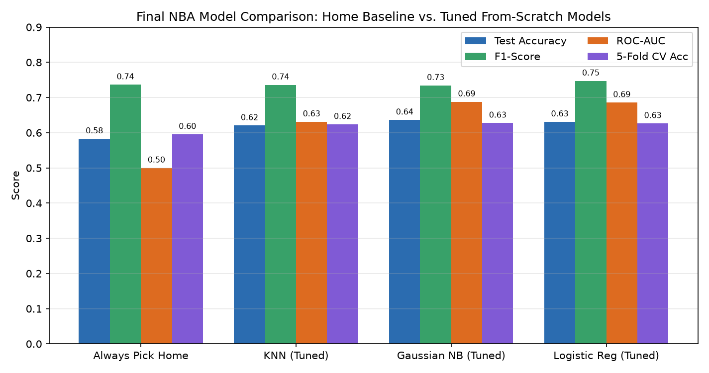

# NBA Game Outcome Predictor (From Scratch)

An NBA game outcome predictor that estimates whether the **home team wins** a regular-season game using pre-tipoff team statistics. The project implements three machine learning algorithms entirely from scratch using Python and NumPy, without relying on machine learning libraries such as `scikit-learn` or data-processing libraries such as `pandas`.

The project was developed as an exercise in understanding the fundamentals of machine learning, from data preparation and feature engineering to model implementation, evaluation, cross-validation, and hyperparameter tuning.

---

## Table of Contents

- [Project Overview](#project-overview)
- [Dataset and Preprocessing](#dataset-and-preprocessing)
- [Models Implemented](#models-implemented)
- [Milestone 2: Initial Model Implementation](#milestone-2-initial-model-implementation)
- [Milestone 3: Model Evaluation and Benchmarking](#milestone-3-model-evaluation-and-benchmarking)
- [Milestone 4: Hyperparameter Tuning](#milestone-4-hyperparameter-tuning)
- [Final Results](#final-results)
- [Visualizations](#visualizations)
- [Repository Structure](#repository-structure)
- [Installation and Usage](#installation-and-usage)
- [Technologies Used](#technologies-used)

---

## Project Overview

The objective is to predict the outcome of an NBA regular-season game using statistics available **before tip-off**.

The target variable is:

| Value | Meaning |
|:---:|---|
| `1` | Home team wins |
| `0` | Away team wins |

Three classification algorithms were implemented from scratch:

1. **K-Nearest Neighbors (KNN)**
2. **Gaussian Naive Bayes**
3. **Logistic Regression**

The project was completed across three main milestones:

- **Milestone 2:** Implement the initial models and establish baseline predictions.
- **Milestone 3:** Evaluate and compare the models using classification metrics and chronological cross-validation.
- **Milestone 4:** Tune model hyperparameters and compare the optimized models against their original versions.

## Dataset and Preprocessing

### Dataset Sources

The prepared dataset is located at:

`clean/nba_2022_23_prepared.csv`

It contains **931 NBA games** from the 2022–2023 regular season, covering October 18, 2022 to February 28, 2023.

The prepared dataset was constructed using:

- `nba_games_clean.csv` — NBA game logs from the 2022–2023 season.
- `all_seasons_clean.csv` — historical player statistics covering the 1996–1997 through 2022–2023 seasons.

### Feature Selection

The final dataset contains **23 pre-tipoff team statistics**.

Features were organized into five general categories:

| Category | Description |
|---|---|
| Season Record | Team performance and win percentage |
| Scoring | Points scored and points allowed |
| Point Differential | Differences in scoring performance |
| Recent Form | Statistics from the team's last five games |
| Rest and Fatigue | Rest days and back-to-back game indicators |

The preprocessing stage removed five game ID or target-related columns and 36 prior-season player-statistic columns (`*_prev_*`), retaining the 23 selected current-season team features.

### Chronological Train-Test Split

The dataset uses an **80/20 chronological split without shuffling**.

| Dataset | Games | Date Range | Home Win Rate |
|---|---:|---|---:|
| Training Set | 744 | Oct. 18, 2022 – Jan. 28, 2023 | 59.95% |
| Testing Set | 187 | Jan. 28, 2023 – Feb. 28, 2023 | 58.29% |
| **Total** | **931** | **Oct. 18, 2022 – Feb. 28, 2023** | |

Games are sorted by date and game ID before splitting. The split is performed by individual game position, not by calendar date. Consequently, games played on January 28 may appear in both sets, but the training and testing sets contain separate game records.

This chronological approach helps prevent future games from being used to train models that predict earlier games.

### Feature Scaling

Features are standardized using the following calculation, as implemented in `data_utils.py`:

```text
(X - mean) / std
```

Where:

- `X` represents the original feature values.
- `mean` is calculated from the training data.
- `std` is the standard deviation calculated from the training data.

The mean and standard deviation are computed exclusively from the training set. The same values are then used to scale both the training and testing data, preventing information from the test set from influencing preprocessing.

---

## Models Implemented

All three classification algorithms are implemented in `models.py`.

### 1. K-Nearest Neighbors (KNN)

KNN predicts a game's outcome by identifying the `k` most similar historical games using Euclidean distance.

The predicted home-win probability is based on the proportion of home wins among those nearest neighbors.

The implementation uses standardized features so that variables with larger numerical scales do not dominate distance calculations.

### 2. Gaussian Naive Bayes

Gaussian Naive Bayes estimates the probability of each class using Bayes' theorem.

It assumes that each feature follows a Gaussian distribution within each class and that features are conditionally independent given the class.

The implementation calculates probabilities in log-space to improve numerical stability.

### 3. Logistic Regression

Logistic Regression estimates the probability of a home-team victory using a sigmoid activation function, implemented in `models.py`:

```text
sigmoid(z) = 1 / (1 + exp(-z))
```

The function converts the model's calculated score into a probability between 0 and 1.

The model learns feature weights through batch gradient descent and supports optional L2 regularization to reduce overly large weights.

---

## Milestone 2: Initial Model Implementation

The second milestone focused on implementing the three algorithms and establishing an initial performance baseline.

The models were trained using the 744-game training set and evaluated on the 187-game testing set.

The initial implementation established that the models could learn relationships between pre-tipoff team statistics and game outcomes.

The milestone also provided the foundation for subsequent evaluation and tuning.

**Main implementation components:**

- Data loading and preprocessing.
- Feature selection and standardization.
- Initial KNN, Gaussian Naive Bayes, and Logistic Regression implementations.
- Baseline predictions and sample outputs.

Run the milestone using:

```bash
python run_milestone2.py
```

---

## Milestone 3: Model Evaluation and Benchmarking

The third milestone expanded the evaluation process beyond accuracy.

### Evaluation Metrics

The following metrics were implemented in `metrics.py`:

| Metric | Purpose |
|---|---|
| Accuracy | Percentage of correctly classified games |
| Precision | Percentage of predicted home wins that were correct |
| Recall | Percentage of actual home wins correctly identified |
| F1-Score | Harmonic mean of precision and recall |
| ROC-AUC | Measures how well the model distinguishes between the two classes |
| Log-Loss | Measures the quality of predicted probabilities |
| Confusion Matrix | Summarizes correct and incorrect predictions |

### Baseline Comparison

An additional baseline was included: **Always Pick Home**.

This baseline predicts that the home team wins every game. Since 58.29% of the testing games were home wins, it achieves 58.29% accuracy without learning any patterns from the features.

| Model | Test Accuracy | Precision | Recall | F1-Score | ROC-AUC | Log-Loss |
|---|---:|---:|---:|---:|---:|---:|
| Always Pick Home | 58.29% | 58.29% | 100.00% | 73.65% | 0.500 | 0.6799 |
| KNN (`k=15`) | 63.10% | 65.15% | 78.90% | 71.37% | 0.655 | 0.6370 |
| Gaussian NB | 62.57% | 65.12% | 77.06% | 70.59% | 0.678 | 0.7049 |
| Logistic Regression | 63.10% | 62.66% | 90.83% | 74.16% | 0.663 | 0.6427 |

### Confusion Matrices

The confusion matrices provide a more detailed view of each model's predictions.

The testing set contains 109 home wins and 78 away wins.

| Model | True Away Wins | False Home Wins | False Away Wins | True Home Wins |
|---|---:|---:|---:|---:|
| KNN | 32 | 46 | 23 | 86 |
| Gaussian NB | 33 | 45 | 25 | 84 |
| Logistic Regression | 19 | 59 | 10 | 99 |

### 5-Fold Expanding-Window Time-Series Cross-Validation

To evaluate model consistency, the training set was also evaluated using five chronological expanding-window folds.

Unlike ordinary random cross-validation, expanding-window validation preserves chronological order. Each fold trains on earlier games and validates on a subsequent block of games.

| Model | Mean CV Accuracy | Standard Deviation |
|---|---:|---:|
| Always Pick Home | 59.54% | 2.74% |
| KNN | 59.79% | 4.11% |
| Gaussian NB | 58.76% | 5.80% |
| Logistic Regression | 61.98% | 2.28% |

Logistic Regression achieved the strongest mean cross-validation accuracy among the three initial models.

Run the evaluation using:

```bash
python test_bench.py
```

---

## Milestone 4: Hyperparameter Tuning

The fourth milestone focused on improving model performance through hyperparameter optimization.

Tuning was performed exclusively within the 744-game training set using five-fold expanding-window chronological cross-validation. The 187-game test set remained untouched until the final evaluation.

### Hyperparameter Search

A total of **46 configurations** were evaluated.

| Model | Hyperparameter | Configurations |
|---|---|---:|
| KNN | Number of neighbors (`k`) | 8 |
| Gaussian Naive Bayes | Variance smoothing | 8 |
| Logistic Regression | Learning rate, epochs, and L2 regularization | 30 |
| **Total** | | **46** |

The best configuration for each model was selected using cross-validation accuracy, with ROC-AUC and log-loss used as tie-breakers.

The complete tuning results are saved in `results/tuning_results.csv`, while the selected hyperparameters are stored in `results/best_hyperparams.json`.

### Selected Hyperparameters

| Model | Original Settings | Tuned Settings |
|---|---|---|
| KNN | `k=15` | `k=35` |
| Gaussian NB | `var_smoothing=1e-6` | `var_smoothing=1.0` |
| Logistic Regression | `lr=0.05, epochs=1000, l2=0` | `lr=0.05, epochs=1000, l2=0.1` |

### Interpretation

**KNN:** Increasing the number of neighbors from 15 to 35 improved its cross-validation accuracy. However, its final test accuracy decreased slightly, illustrating that better validation performance does not guarantee better holdout performance.

**Gaussian Naive Bayes:** Increasing variance smoothing to 1.0 produced the strongest final test accuracy and ROC-AUC among the tuned models. The larger smoothing value helped stabilize probability estimates when working with correlated team statistics.

**Logistic Regression:** Adding L2 regularization helped stabilize the learned feature weights. The tuned model achieved the highest F1-score among the evaluated models.

Run the tuning and final evaluation using:

```bash
python tune_models.py
python run_milestone4.py
```

---

## Final Results

The following table summarizes the baseline, untuned models, and tuned models on the same 187-game holdout test set.

| Model | Settings | Accuracy | Precision | Recall | F1-Score | ROC-AUC | Log-Loss | 5-Fold CV |
|---|---|---:|---:|---:|---:|---:|---:|---:|
| Always Pick Home | `home_win=1` | 58.29% | 58.29% | 100.00% | 73.65% | 0.500 | 0.6799 | 59.54% |
| KNN (Untuned) | `k=15` | 63.10% | 65.15% | 78.90% | 71.37% | 0.655 | 0.6370 | 59.79% |
| KNN (Tuned) | `k=35` | 62.03% | 61.88% | 90.83% | 73.61% | 0.631 | 0.6432 | 62.37% |
| Gaussian NB (Untuned) | `var_smoothing=1e-6` | 62.57% | 65.12% | 77.06% | 70.59% | 0.678 | 0.7049 | 58.76% |
| **Gaussian NB (Tuned)** | `var_smoothing=1.0` | **63.64%** | 63.95% | 86.24% | 73.44% | **0.688** | **0.6188** | **62.76%** |
| Logistic Regression (Untuned) | `lr=0.05, epochs=1000, l2=0` | 63.10% | 62.66% | 90.83% | 74.16% | 0.663 | 0.6427 | 61.98% |
| **Logistic Regression (Tuned)** | `lr=0.05, epochs=1000, l2=0.1` | 63.10% | 62.20% | 93.58% | **74.73%** | 0.686 | 0.6413 | 62.63% |

### Key Findings

- **Best Accuracy:** Tuned Gaussian Naive Bayes achieved 63.64% accuracy, outperforming the always-pick-home baseline by 5.35 percentage points.
- **Best ROC-AUC:** Tuned Gaussian Naive Bayes achieved 0.688, the highest ROC-AUC among the evaluated models.
- **Best F1-Score:** Tuned Logistic Regression achieved 74.73%, demonstrating a strong balance between precision and recall.
- **Best Cross-Validation Accuracy:** Tuned Gaussian Naive Bayes achieved 62.76% mean accuracy across the five chronological folds.
- **Tuning does not guarantee improvement in every metric:** KNN's test accuracy decreased after tuning, while its recall and cross-validation accuracy improved.

Overall, Gaussian Naive Bayes achieved the strongest test accuracy and probability-based metrics, while Logistic Regression performed best in terms of F1-score.

### Logistic Regression Feature Importance

The learned Logistic Regression coefficients provide an indication of which features contributed most strongly to the model's predictions.

The five strongest features by absolute coefficient magnitude were:

| Feature | Weight |
|---|---:|
| `home_avg_point_diff` | +0.102 |
| `visitor_is_b2b` | +0.097 |
| `diff_avg_point_diff` | +0.088 |
| `home_avg_pts_allowed` | -0.064 |
| `home_win_pct` | +0.056 |

Positive coefficients increase the model's predicted home-win probability, while negative coefficients decrease it, assuming other features remain unchanged.

These coefficients describe the model's learned relationships; they should not be interpreted as proof of causation.

---

## Visualizations

The project generates six charts to illustrate model performance, classification behavior, and the effects of hyperparameter tuning.

### Milestone 3 — Model Evaluation

**Model Metrics Comparison**

Compares the initial models across multiple evaluation metrics.


**Confusion Matrices**

Shows the correct and incorrect classifications made by each model.


**ROC Curves**

Compares the ability of each model to distinguish between home wins and away wins across classification thresholds.


### Milestone 4 — Hyperparameter Tuning

**Untuned vs. Tuned Performance**

Compares the performance of each model before and after hyperparameter optimization.


**Feature Importance**

Displays the ten most influential Logistic Regression features based on their learned coefficients.


**Final Model Comparison**

Summarizes the performance of the baseline and the final tuned models.



---

## Repository Structure

```text
NbaGamesPredictor/
│
├── clean/
│   ├── nba_2022_23_prepared.csv
│   ├── nba_games_clean.csv
│   └── all_seasons_clean.csv
│
├── plots/
│   ├── model_metrics_comparison.png
│   ├── confusion_matrices.png
│   ├── roc_curves.png
│   ├── tuned_vs_untuned.png
│   ├── feature_importance.png
│   └── final_model_comparison.png
│
├── results/
│   ├── best_hyperparams.json
│   ├── tuning_results.csv
│   └── milestone4_results.csv
│
├── reports/
│   └── Milestone-related report files
│
├── data_utils.py
├── models.py
├── metrics.py
├── run_milestone2.py
├── test_bench.py
├── tune_models.py
└── run_milestone4.py
```

---

## Installation and Usage

### Requirements

- Python 3
- NumPy
- Matplotlib (used for generating charts)

The machine learning algorithms and evaluation metrics are implemented without `scikit-learn` or `pandas`.

### 1. Clone the Repository

```bash
git clone https://github.com/Gab172005/NbaGamesPredictor.git
cd NbaGamesPredictor
```

### 2. Install Dependencies

```bash
pip install numpy matplotlib
```

### 3. Run the Milestones

**Milestone 2 — Initial Model Implementation**

```bash
python run_milestone2.py
```

**Milestone 3 — Model Evaluation and Benchmarking**

```bash
python test_bench.py
```

**Milestone 4 — Hyperparameter Tuning**

```bash
python tune_models.py
```

**Milestone 4 — Final Evaluation and Visualizations**

```bash
python run_milestone4.py
```

Generated evaluation charts and result files are saved in their respective directories.

---

## Technologies Used

| Technology | Purpose |
|---|---|
| Python | Main programming language |
| NumPy | Numerical computation and array operations |
| Matplotlib | Generating evaluation and comparison charts |
| Git and GitHub | Version control and project collaboration |

### Implementation Constraints

The project emphasizes implementing machine learning fundamentals rather than relying on prebuilt machine learning frameworks.

- No `scikit-learn` for model implementation, training, or evaluation.
- No `pandas` for data manipulation.
- NumPy is used for numerical operations.
- Matplotlib is used exclusively for visualizations.

---

## Project Goal

This project demonstrates how fundamental machine learning algorithms can be implemented, evaluated, and improved from scratch.

Beyond predicting NBA game outcomes, it provides practical experience with data preprocessing, feature selection, classification algorithms, evaluation metrics, chronological cross-validation, and hyperparameter optimization.

