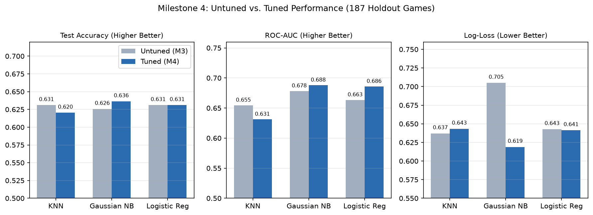
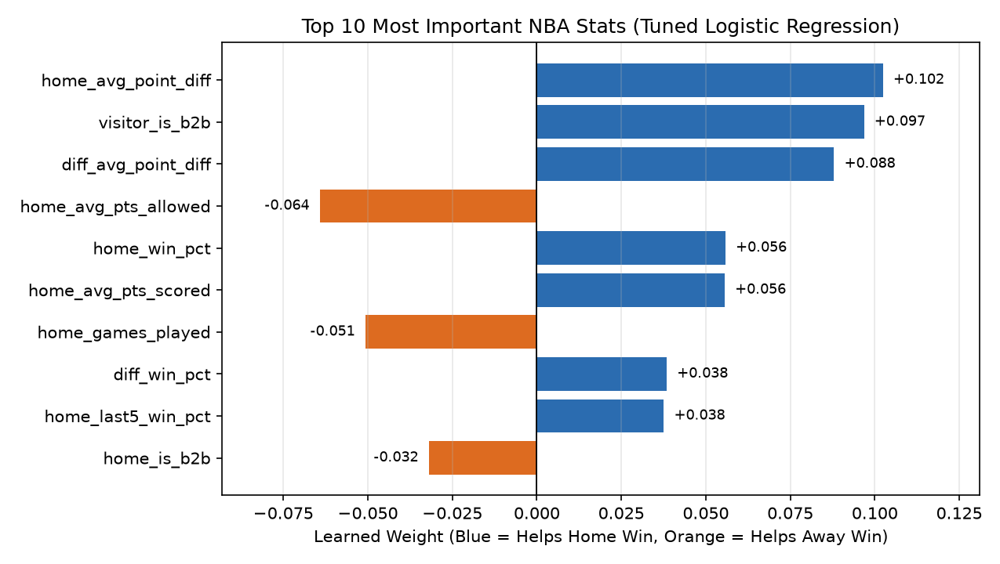

# NBA Game Outcome Predictor (From Scratch)

Predicts whether the **home team wins** an NBA regular-season game (`home_win`: `1` = Home Win, `0` = Away Win) using pre-tipoff team stats. Built **100% from scratch** with Python's standard library and `numpy` — no `pandas` or `scikit-learn` (`matplotlib` is used only for saving charts).

---

## Dataset & Leak-Free Setup

- **Dataset (`clean/nba_2022_23_prepared.csv`):** 931 games from the 2022–23 NBA regular season (`2022-10-18` to `2023-02-28`, 0 missing values), built from `nba_games_clean.csv` (2022–23 game logs) and `all_seasons_clean.csv` (1996–97 to 2022–23 player stats).
- **Features (23 Pre-Tipoff Team Stats):** Dropped 5 game ID/target columns and 36 prior-season player columns (`*_prev_*`), keeping 23 current-season team stats across season record, scoring, point differential, last-5-game form, and rest/back-to-back fatigue.
- **Chronological 80/20 Split (No Shuffling):**
  - **Train (first 80%):** 744 games (`2022-10-18` to `2023-01-28`, 59.95% home wins)
  - **Test (last 20%):** 187 games (`2023-01-28` to `2023-02-28`, 58.29% home wins)
- **Scaling:** Standardized with `(x - mean) / std` fit strictly on the training set.

---

## Models Built From Scratch (`models.py`)

1. **K-Nearest Neighbors (`KNN`):** Euclidean distance over standardized features; predicts home-win probability from the `k` closest historical matchups.
2. **Gaussian Naive Bayes (`GaussianNB`):** Models per-class feature distributions as Gaussian bell curves and computes probabilities in log-space.
3. **Logistic Regression (`LogisticRegression`):** Batch gradient descent with sigmoid activation and optional L2 weight regularization.

---

## Final Results (187 Holdout Test Games & 5-Fold Time-Series CV)

Hyperparameters were tuned strictly inside the 744 training games via 5-fold expanding-window chronological CV (`tune_models.py`), keeping the 187 test games untouched until final evaluation:

| Model | Settings | Test Acc | Precision | Recall | F1-Score | ROC-AUC | Log-Loss | 5-Fold CV |
| :--- | :--- | :---: | :---: | :---: | :---: | :---: | :---: | :---: |
| Always Pick Home | `home_win = 1` | 58.29% | 58.29% | 100.00% | 73.65% | 0.500 | 0.6799 | 59.54% |
| `KNN` (Untuned) | `k=15` | 63.10% | 65.15% | 78.90% | 71.37% | 0.655 | 0.6370 | 59.79% |
| `KNN` (Tuned) | `k=35` | 62.03% | 61.88% | 90.83% | 73.61% | 0.631 | 0.6432 | 62.37% |
| `Gaussian NB` (Untuned) | `var_smoothing=1e-6` | 62.57% | 65.12% | 77.06% | 70.59% | 0.678 | 0.7049 | 58.76% |
| **`Gaussian NB` (Tuned)** | `var_smoothing=1.0` | **63.64%** | 63.95% | 86.24% | 73.44% | **0.688** | **0.6188** | **62.76%** |
| `Logistic Reg` (Untuned) | `lr=0.05, ep=1000, l2=0` | 63.10% | 62.66% | 90.83% | 74.16% | 0.663 | 0.6427 | 61.98% |
| **`Logistic Reg` (Tuned)** | `lr=0.05, ep=1000, l2=0.1` | 63.10% | 62.20% | 93.58% | **74.73%** | 0.686 | 0.6413 | 62.63% |

### Key Takeaways
- **Tuned Gaussian NB finished #1 overall:** Increasing `var_smoothing` to `1.0` widened feature variances and fixed the probability overconfidence caused by correlated team stats — reaching **63.64% test accuracy** (`+5.35%` over baseline), **0.688 ROC-AUC**, **0.6188 Log-Loss**, and **62.76% 5-fold CV**.
- **Tuned Logistic Regression led F1 (74.73%):** Light L2 regularization (`0.1`) stabilized weights across overlapping features, lifting ROC-AUC from `0.663` to `0.686`.
- **Top NBA Predictors:** Point differential (`home_avg_point_diff`, `diff_avg_point_diff`) and back-to-back fatigue (`visitor_is_b2b`, `home_is_b2b`) carried stronger weights than raw win percentage alone.

---

## Charts


| Untuned vs. Tuned | Top 10 NBA Features |
| :---: | :---: |
|  |  |

---

## Repository Structure

```text
NbaGamesPredictor/
├── clean/                  # Prepared 2022-23 game dataset & source CSVs
├── plots/                  # Saved evaluation & tuning charts
├── results/                # Best hyperparameters JSON & benchmark CSV logs
├── reports/                # Detailed text summaries for Milestones 2–4
├── data_utils.py           # Loader, 23-feature selector, chronological split & scaler
├── models.py               # From-scratch KNN, GaussianNB & LogisticRegression
├── metrics.py              # From-scratch Confusion Matrix, Acc, Prec, Rec, F1, AUC, Log-Loss
├── run_milestone2.py       # Milestone 2: baseline accuracy & sample predictions
├── test_bench.py           # Milestone 3: full metrics benchmark & 5-fold time-series CV
├── tune_models.py          # Milestone 4: train-only expanding-window grid search
└── run_milestone4.py       # Milestone 4: untuned vs. tuned comparison & final plots
