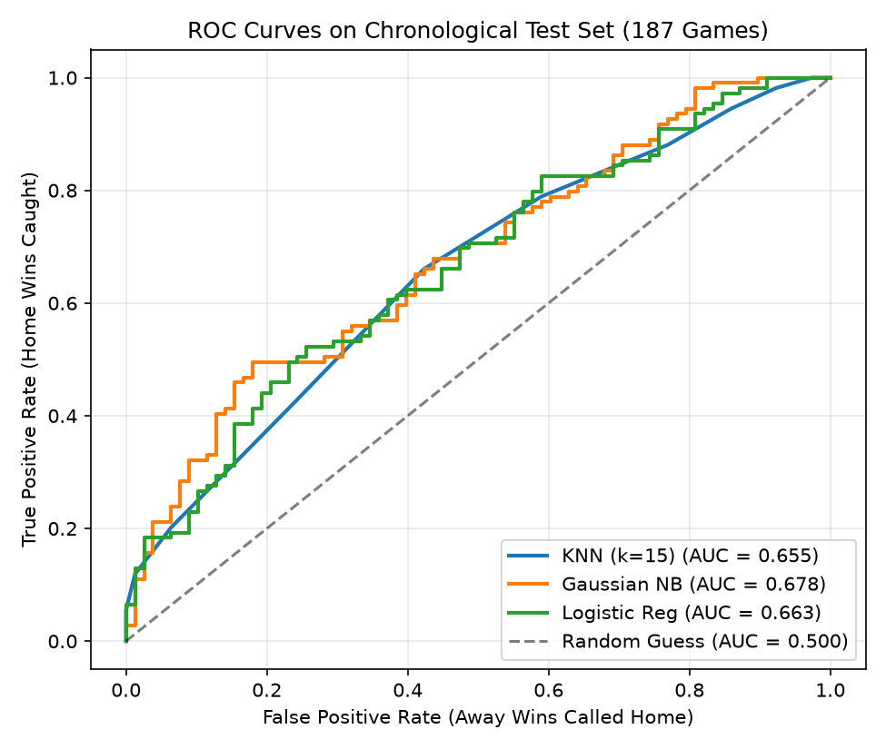

# NBA Game Outcome Predictor (Built From Scratch)

A beginner-friendly machine learning project that predicts whether the **home team wins** an NBA regular-season game (`home_win`: `1` = Home Win, `0` = Away Win) using **three algorithms built 100% from scratch** with only Python's standard library (`csv`, `math`, `json`) and `numpy` — no `scikit-learn` or `pandas`. (`matplotlib` is used strictly to generate charts.)

---

## Whole-Project Overview

- **Goal:** Predict NBA game outcomes before tipoff using easy-to-explain team performance, momentum, and schedule-fatigue stats, and compare three classic ML algorithms fairly without any data leakage.
- **Dataset:** `clean/nba_2022_23_prepared.csv` — **931 regular-season games** from the 2022–23 NBA season (`2022-10-18` to `2023-02-28`, 0 missing values).
- **Features Used (23 Direct Team Stats):** We dropped the 36 prior-season player-stat columns (`*_prev_*`) and kept only the 23 clear, current-season pre-game team stats:
  - **Season Record & Games Played (5):** `home_games_played`, `visitor_games_played`, `home_win_pct`, `visitor_win_pct`, `diff_win_pct`
  - **Scoring & Point Differential (7):** `home_avg_point_diff`, `visitor_avg_point_diff`, `diff_avg_point_diff`, `home_avg_pts_scored`, `visitor_avg_pts_scored`, `home_avg_pts_allowed`, `visitor_avg_pts_allowed`
  - **Recent 5-Game Form (6):** `home_last5_win_pct`, `visitor_last5_win_pct`, `diff_last5_win_pct`, `home_last5_point_diff`, `visitor_last5_point_diff`, `diff_last5_point_diff`
  - **Rest & Fatigue (5):** `home_rest_days`, `visitor_rest_days`, `diff_rest_days`, `home_is_b2b`, `visitor_is_b2b`
- **Chronological 80/20 Split (No Random Shuffling):**
  - **Training Set (first 80%):** 744 games (`2022-10-18` to `2023-01-28`) — 59.95% home wins
  - **Test Set (last 20%):** 187 games (`2023-01-28` to `2023-02-28`) — 58.29% home wins
  - Sorting by `(date, game_id)` ensures we only ever use past games to predict future games. Features are standardized with `(x - mean) / std` computed **strictly on the training set**.
- **Baseline Benchmark:** **Always Pick Home Team** (`58.29%` test accuracy), reflecting natural NBA home-court advantage.

---

## Milestone 2 — Data Pipeline & Three From-Scratch Models

**Files:** `data_utils.py`, `models.py`, `run_milestone2.py`, `milestone_2.txt`

In Milestone 2, we built the complete loading, chronological splitting, and scaling pipeline along with all three from-scratch models in one clean file (`models.py`), each supporting `.fit(X, y)`, `.predict_proba(X)`, and `.predict(X)`:

1. **K-Nearest Neighbors (`KNN`, default `k=15`):** Stores the scaled training games. For a new game, it calculates the straight-line (Euclidean) distance to every past game, finds the 15 most similar matchups, and estimates the home-win probability by taking a vote among them.
2. **Gaussian Naive Bayes (`GaussianNB`, default `var_smoothing=1e-6`):** Computes the mean and variance of each stat separately for past home wins vs. home losses. For a new game, it compares how well the stats match each bell curve (in log-space to avoid tiny-number underflow) and picks the higher-probability winner.
3. **Logistic Regression (`LogisticRegression`, default `lr=0.05, epochs=1000`):** Learns one weight per stat plus a bias term using simple batch gradient descent, then passes the weighted sum through a sigmoid curve to output a 0%–100% home-win probability.

### Initial Baseline Results (`python run_milestone2.py`)

| Model | Train Accuracy | Test Accuracy | vs. Baseline (Test) |
| :--- | :---: | :---: | :---: |
| Always Pick Home (Baseline) | 59.95% | 58.29% | -- |
| `KNN (k=15)` | 65.46% | 63.10% | +4.81% |
| `Gaussian Naive Bayes` | 61.29% | 62.57% | +4.28% |
| `Logistic Regression` | 62.77% | 63.10% | +4.81% |

All three untuned models beat the home-team baseline by more than 4 percentage points on unseen late-season games with minimal overfitting.

---

## Milestone 3 — Custom Evaluation Metrics, 5-Fold Time-Series CV & Plots

**Files:** `metrics.py`, `test_bench.py`, `milestone3_results.csv`, `milestone_3.txt`, `plots/model_metrics_comparison.png`, `plots/confusion_matrices.png`, `plots/roc_curves.png`

Because home teams win nearly 60% of games, accuracy alone can hide bias. In Milestone 3, we implemented **7 evaluation metrics from scratch** in `metrics.py`:

- **Confusion Matrix (`TN`, `FP`, `FN`, `TP`)** — shows exact home-win vs. away-win hits and misses.
- **Accuracy, Precision, Recall, and F1-Score** — balance overall correctness against false home picks and missed home wins.
- **ROC-AUC** (manual trapezoid rule) — measures probability ranking quality across all thresholds (`0.50` = random guess).
- **Log-Loss** — checks probability calibration by heavily penalizing overconfident wrong picks (lower is better).
- **5-Fold Expanding-Window Time-Series CV** — splits the season into 6 chronological blocks (~155 games each), always training on earlier blocks and validating on the next unseen block.

### Milestone 3 Benchmark (`python test_bench.py`)

| Model | Test Acc | Precision | Recall | F1-Score | ROC-AUC | Log-Loss | 5-Fold CV | TN / FP / FN / TP |
| :--- | :---: | :---: | :---: | :---: | :---: | :---: | :---: | :---: |
| Always Pick Home | 58.29% | 58.29% | 100.00% | 73.65% | 0.500 | 0.6799 | 59.54% | `0 / 78 / 0 / 109` |
| `KNN (k=15)` | 63.10% | 65.15% | 78.90% | 71.37% | 0.655 | 0.6370 | 59.79% | `32 / 46 / 23 / 86` |
| `Gaussian NB` | 62.57% | 65.12% | 77.06% | 70.59% | 0.678 | 0.7049 | 58.76% | `33 / 45 / 25 / 84` |
| `Logistic Reg` | 63.10% | 62.66% | 90.83% | 74.16% | 0.663 | 0.6427 | 61.98% | `19 / 59 / 10 / 99` |

**Key Milestone 3 Diagnosis:**
- **Logistic Regression** was the steadiest across the full season (`61.98%` 5-fold CV) and led F1 (`74.16%`).
- **KNN** had the best initial Log-Loss (`0.6370`) and balanced home/away picks (`TN=32`).
- **Gaussian Naive Bayes** achieved the top ROC-AUC (`0.678`) in `<0.3 ms`, but had the worst Log-Loss (`0.7049`) because correlated stats (like `home_win_pct` and `diff_win_pct`) made it double-count evidence and output overly extreme probabilities.

| Confusion Matrices (Milestone 3) | ROC Curves (Milestone 3) |
| :---: | :---: |
|  |  |

---

## Milestone 4 — Leak-Free Hyperparameter Tuning & Final Insights

**Files:** `tune_models.py`, `best_hyperparams.json`, `tuning_results.csv`, `run_milestone4.py`, `milestone4_results.csv`, `milestone_4.txt`, `plots/tuned_vs_untuned.png`, `plots/feature_importance.png`, `plots/final_model_comparison.png`

To tune fairly without cheating (**Strict Vault Rule**), `tune_models.py` locked the 187 test games away and tested **46 configurations** strictly inside the first 744 training games using 5 expanding chronological folds (124 games per block), adding optional light L2 regularization (`l2`) to `LogisticRegression`.

- **Winning Settings (Chosen Only on Training CV):**
  - `KNN`: `k = 35`
  - `Gaussian NB`: `var_smoothing = 1.0`
  - `Logistic Reg`: `lr = 0.05, epochs = 1000, l2 = 0.1`

### Final Untuned vs. Tuned Results (`python run_milestone4.py`)

| Model | Settings | Test Acc | Precision | Recall | F1-Score | ROC-AUC | Log-Loss | 5-Fold CV |
| :--- | :--- | :---: | :---: | :---: | :---: | :---: | :---: | :---: |
| Always Pick Home | `home_win = 1` | 58.29% | 58.29% | 100.00% | 73.65% | 0.500 | 0.6799 | 59.54% |
| `KNN` (Untuned) | `k=15` | 63.10% | 65.15% | 78.90% | 71.37% | 0.655 | 0.6370 | 59.79% |
| `KNN` (Tuned) | `k=35` | 62.03% | 61.88% | 90.83% | 73.61% | 0.631 | 0.6432 | 62.37% |
| `Gaussian NB` (Untuned) | `var_smoothing=1e-6` | 62.57% | 65.12% | 77.06% | 70.59% | 0.678 | 0.7049 | 58.76% |
| **`Gaussian NB` (Tuned)** | `var_smoothing=1.0` | **63.64%** | 63.95% | 86.24% | 73.44% | **0.688** | **0.6188** | **62.76%** |
| `Logistic Reg` (Untuned) | `lr=0.05, ep=1000, l2=0` | 63.10% | 62.66% | 90.83% | 74.16% | 0.663 | 0.6427 | 61.98% |
| **`Logistic Reg` (Tuned)** | `lr=0.05, ep=1000, l2=0.1` | 63.10% | 62.20% | 93.58% | **74.73%** | 0.686 | 0.6413 | 62.63% |

### Key Takeaways & Basketball Insights
- **Tuned Gaussian Naive Bayes Finished #1 Overall:** Widening the bell curves with `var_smoothing=1.0` solved the Milestone 3 overconfidence issue — lifting Test Accuracy to **63.64%** (**+5.35%** vs. baseline), ROC-AUC to **0.688**, full-season 5-fold CV to **62.76%**, and slashing Log-Loss from `0.7049` down to **0.6188**.
- **Tuned Logistic Regression Sharpened Ranking & Interpretability:** Light L2 regularization (`l2=0.1`) lifted ROC-AUC (`0.663 → 0.686`), achieved the top F1-Score (**74.73%**), and improved 5-fold CV (`61.98% → 62.63%`).
- **KNN Illustrated the Bias-Variance Trade-Off:** Increasing `k` from `15` to `35` boosted full-season 5-fold CV (`59.79% → 62.37%`) while dipping slightly on the single 187-game holdout window (`63.10% → 62.03%`).
- **What Stats Actually Win NBA Games:** Tuned Logistic Regression's top weights highlight real basketball fundamentals — **home average point differential (`+0.102`)**, **visiting team on a back-to-back (`+0.097`)**, **point-differential gap (`+0.088`)**, **home points allowed (`-0.064`)**, and **home win percentage (`+0.056`)**.
- **Realistic Sports Ceiling:** Even professional oddsmakers average roughly ~66–69% over an NBA season because injuries, rest days, trades, and shooting variance happen every night. Reaching **63.64% accuracy / 0.688 AUC** purely from scratch shows simple models capture genuine basketball signal.

### Milestone 4 Charts

#### Final Model Comparison


#### Untuned (Milestone 3) vs. Tuned (Milestone 4)


#### Top 10 Most Important NBA Stats (Tuned Logistic Regression)


---

## Project Structure

```text
NBAPredictor/
├── clean/
│   ├── nba_2022_23_prepared.csv    # Prepared 931-game dataset used by all scripts
│   ├── nba_games_clean.csv         # Cleaned raw game scores
│   └── all_seasons_clean.csv       # Historical player-season stats
├── data_utils.py                   # CSV loader, 23-feature selector, 80/20 split, scaler
├── models.py                       # From-scratch KNN, GaussianNB, LogisticRegression
├── metrics.py                      # From-scratch Accuracy, Precision, Recall, F1, AUC, Log-Loss
├── run_milestone2.py               # Milestone 2: train/test accuracy & example predictions
├── test_bench.py                   # Milestone 3: full metrics benchmark, 5-fold CV & plots
├── tune_models.py                  # Milestone 4: train-only expanding-window grid search
├── run_milestone4.py               # Milestone 4: untuned vs. tuned evaluation & final charts
├── best_hyperparams.json           # Winning hyperparameters picked on training CV only
├── milestone3_results.csv          # Milestone 3 metrics log
├── tuning_results.csv              # All 46 tested tuning configurations
├── milestone4_results.csv          # Final Untuned vs. Tuned comparison table
├── milestone_2.txt                 # Plain-English Milestone 2 summary
├── milestone_3.txt                 # Plain-English Milestone 3 summary
├── milestone_4.txt                 # Plain-English Milestone 4 final report
└── plots/                          # Saved matplotlib charts (6 total across M3 & M4)
```

---

## How to Run

Requires Python 3.10+ with `numpy` and `matplotlib` installed:

```bash
# Milestone 2: Train all 3 models and view example test game predictions
python run_milestone2.py

# Milestone 3: Run full custom metrics benchmark, 5-fold CV, and M3 plots
python test_bench.py

# Milestone 4: Tune hyperparameters strictly on training CV, then run final benchmark
python tune_models.py
python run_milestone4.py
```
