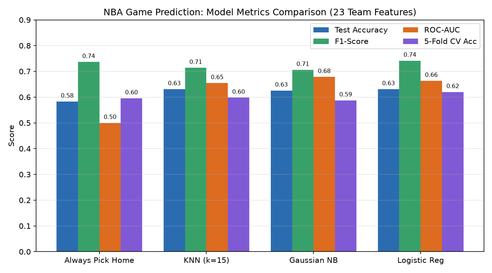
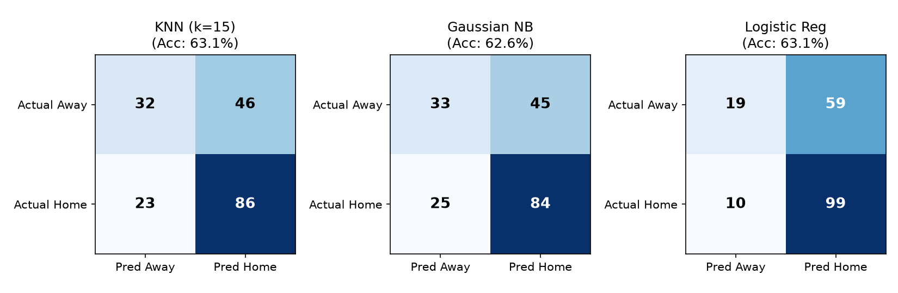

# NBA Game Outcome Predictor — Milestone 3

**Custom Evaluation Metrics, 5-Fold Time-Series Cross-Validation & Benchmark Visualizations**

Building on the from-scratch data pipeline and three classifiers from Milestone 2 (`KNN`, `Gaussian Naive Bayes`, and `Logistic Regression`), Milestone 3 moves beyond plain accuracy to evaluate model quality, probability calibration, and full-season consistency. All metric calculations and cross-validation loops are written **100% from scratch** with Python's standard library (`csv`, `os`, `time`) and `numpy` — no `scikit-learn` or `pandas`. (`matplotlib` is used strictly to save charts.)

---

## Milestone 3 Overview

- **Dataset & Setup:** Evaluated on the **931 regular-season games** from the 2022–23 NBA season (`23` pre-game current-season team stats), using the chronological **80/20 holdout split** (744 training games, 187 unseen test games: 109 home wins and 78 away wins) plus **5-fold expanding-window time-series cross-validation** across the full season.
- **Models Benchmarked (Untuned Baselines from Milestone 2):**
  - `Always Pick Home` (baseline using the training home-win rate as predicted probability)
  - `KNN (k=15)`
  - `Gaussian NB` (`var_smoothing=1e-6`)
  - `Logistic Reg` (`lr=0.05, epochs=1000`)

---

## Custom Metrics & Validation Built From Scratch

Because NBA home teams naturally win ~58–60% of games, accuracy alone can hide one-sided predictions. In `metrics.py` and `test_bench.py`, we implemented **7 evaluation metrics** and **time-series CV** from scratch:

- **Confusion Matrix (`TN`, `FP`, `FN`, `TP`):** Breaks down predictions into exact away-win hits (`TN`), wrong home picks (`FP`), missed home wins (`FN`), and home-win hits (`TP`).
- **Accuracy, Precision, Recall & F1-Score:** Balance overall correctness against false home picks (`TP / (TP + FP)`) and missed home wins (`TP / (TP + FN)`).
- **ROC Curve & ROC-AUC (Trapezoid Rule):** Sweeps all probability thresholds to measure ranking quality across cutoffs (`0.500` = random coin flip, `1.000` = perfect ranking).
- **Log-Loss:** Evaluates probability calibration by heavily penalizing overconfident wrong picks (lower is better).
- **5-Fold Expanding-Window Time-Series CV:** Splits all 931 games (in date order) into 6 chronological blocks (~155 games each), always training on earlier blocks and validating on the next unseen block — with feature standardization computed strictly inside each training fold to prevent data leakage.

---

## Milestone 3 Benchmark Results (`python test_bench.py`)

| Model | Test Acc | Precision | Recall | F1-Score | ROC-AUC | Log-Loss | 5-Fold CV (Mean ± Std) | Fit / Pred (ms) | TN / FP / FN / TP |
| :--- | :---: | :---: | :---: | :---: | :---: | :---: | :---: | :---: | :---: |
| Always Pick Home | 58.29% | 58.29% | 100.00% | 73.65% | 0.500 | 0.6799 | 59.54% ± 2.74% | `0.0 / 0.0` | `0 / 78 / 0 / 109` |
| `KNN (k=15)` | **63.10%** | **65.15%** | 78.90% | 71.37% | 0.655 | **0.6370** | 59.79% ± 4.11% | `0.0 / 8.3` | `32 / 46 / 23 / 86` |
| `Gaussian NB` | 62.57% | 65.12% | 77.06% | 70.59% | **0.678** | 0.7049 | 58.76% ± 5.80% | `0.2 / 0.1` | `33 / 45 / 25 / 84` |
| `Logistic Reg` | **63.10%** | 62.66% | 90.83% | **74.16%** | 0.663 | 0.6427 | **61.98% ± 2.28%** | `25.7 / 0.0` | `19 / 59 / 10 / 99` |

### Key Findings & Diagnosis

1. **Why Accuracy & F1 Alone Are Not Enough:** The `Always Pick Home` baseline scores a high F1 (`73.65%`) purely by predicting home win on every game (`TN = 0`, catching zero away wins). ROC-AUC (`0.500` vs. `0.655–0.678`) and the confusion matrices confirm all three learned models capture real basketball signal.
2. **Logistic Regression Is Most Consistent Across the Season:** Tied for top test accuracy (`63.10%`), posted the highest F1 (`74.16%`), and led 5-fold time-series CV (`61.98% ± 2.28%`). However, it leans heavily toward picking home teams (`TP = 99`, `TN = 19`), pointing to regularization or tuning as a clear improvement target.
3. **KNN Has the Best Probability Calibration:** Tied for best test accuracy (`63.10%`) and achieved the lowest Log-Loss (`0.6370`) because voting across 15 neighbors avoids extreme probabilities. It also catches more road wins than Logistic Regression (`TN = 32` vs. `19`), at a higher prediction latency (`8.3 ms`).
4. **Gaussian Naive Bayes Ranks Best but Is Overconfident:** Achieved the top ROC-AUC (`0.678`) in under `0.3 ms` total, yet had the worst Log-Loss (`0.7049` — worse than the baseline). Because correlated team stats (e.g., `home_win_pct`, `diff_win_pct`, `home_avg_point_diff`) violate Naive Bayes' independence assumption, it double-counts evidence and outputs overly extreme probabilities near 0% or 100%.

---

## Visualizations

### Model Metrics Comparison


| Confusion Matrices | ROC Curves |
| :---: | :---: |
|  |  |

---

## Next Steps (Milestone 4)

Using 5-fold expanding-window CV strictly on the training set (without touching the held-out 187 test games):
- **KNN:** Tune neighborhood size `k` (e.g., `5` to `45`).
- **Gaussian NB:** Tune `var_smoothing` (or smaller uncorrelated feature subsets) to fix probability overconfidence.
- **Logistic Regression:** Tune learning rate, epochs, and light L2 regularization to stabilize weights and reduce home-pick bias.

---

## Milestone 3 Files

```text
NbaGamesPredictor/
├── metrics.py                         # From-scratch Confusion Matrix, Acc, Prec, Rec, F1, ROC-AUC, Log-Loss
├── test_bench.py                      # Benchmark runner: metrics, 5-fold time-series CV, CSV export & plots
├── milestone3_results.csv             # Full Milestone 3 benchmark results table
├── milestone_3.txt                    # Plain-English Milestone 3 summary
├── plots/
│   ├── model_metrics_comparison.png   # Grouped bar chart (Accuracy, F1, ROC-AUC, 5-Fold CV)
│   ├── confusion_matrices.png         # Side-by-side 2x2 confusion matrices
│   └── roc_curves.png                 # ROC curves & AUC comparison
└── README.md                          # Milestone 3 documentation
```

---

## How to Run

Requires Python 3.10+ with `numpy` and `matplotlib` installed (along with the Milestone 2 pipeline files `clean/nba_2022_23_prepared.csv`, `data_utils.py`, and `models.py`):

```bash
# Run full Milestone 3 metrics benchmark, 5-fold time-series CV, CSV export, and plot generation
python test_bench.py
```

